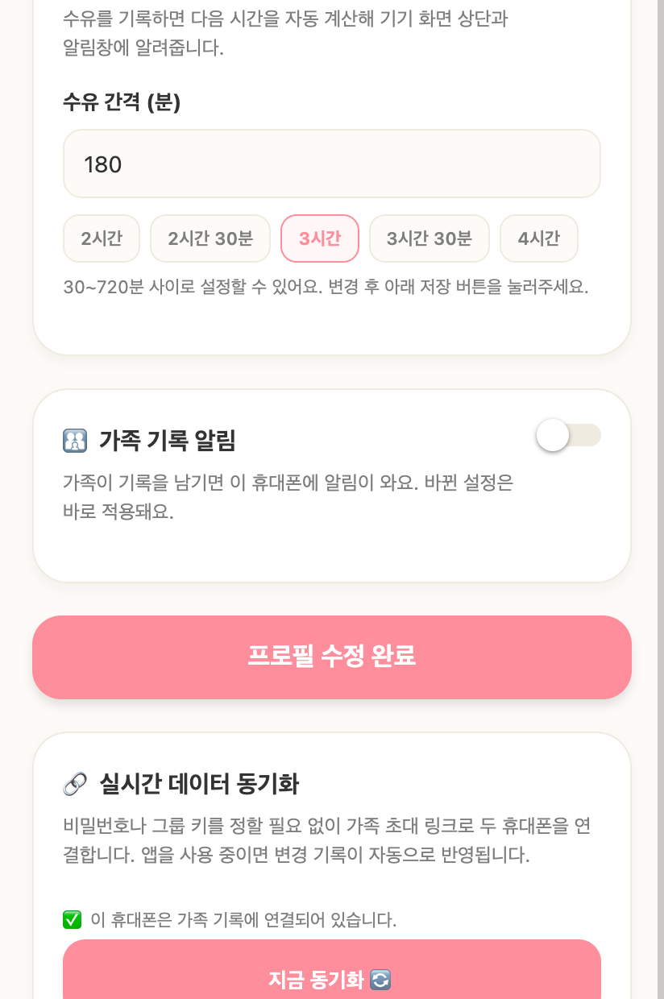
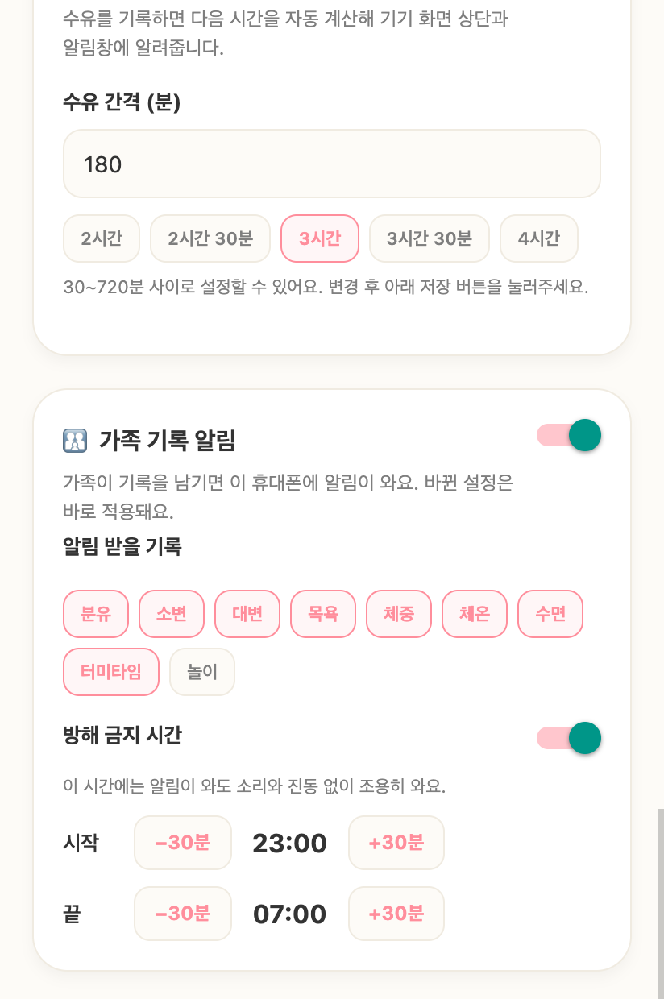

# 04-검증: 상대 기기 기록 알림

- 기준 커밋: `a3c54e1` (브랜치 `feat/partner-push`, origin에 올리지 않음)
- 검증일: 2026-11-13

## 1. 전체 테스트

| 묶음 | 결과 |
|---|---|
| 앱 `npx tsc --noEmit` | rc=0 |
| 서버 `cd server && npx tsc --noEmit` | rc=0 |
| `node tests/partnerPush.mjs` | 44개 통과 |
| `node tests/permissionNotice.mjs` | PASS |
| `verify.sh push` | 25/25 |
| `verify.sh scenario real-scenarios-push.mjs` | 10/10 |
| `verify.sh offline` | rc=0 (단위 117/117, 일기 107/107, real 자체 점검 50/50, 시나리오 1부 22/22, 2부 23/23, 3부 2/2, 4a 17/17, 4b 17/17, 4c 15/15, 4d 3/3, 일기 3/3, 푸시 시나리오 10/10, 푸시 단위 25/25) |

주 세션이 `a3c54e1`에서 tsc 두 개와 `partnerPush`, `push`, 푸시 시나리오를 다시 돌려 같은 결과를 얻었다. `offline` 전체는 구현 에이전트가 돌린 결과다.

`1627118`에서 리뷰 에이전트와 동시에 `offline`을 돌렸을 때 4b 시나리오 [32]가 30초 대기 시간 초과로 한 번 실패했다. 그 파일만 다시 두 번 돌리니 2.7초에 통과했고 `a3c54e1`의 `offline`에서도 통과했다. 부하가 많을 때만 생기는 시간 초과로 본다.

## 2. 대량 업로드 시나리오 (`real-scenarios-push.mjs`)

| ID | 내용 | 기대한 메시지 수 |
|---|---|---|
| PD1 | 새 분유 기록 1건 | B에 1개, A에는 없음 |
| PD2 | 새 기록 3건을 한 번에 | B에 묶음 1개(" 외 2건") |
| PD3 | 수정, 같은 버전 재전송, 삭제 | 0개 |
| PD4 | 오래된 기록 125건 첫 업로드 | 0개 |
| PD4b | 오래된 기록 30건 첫 업로드(40건 상한 아래) | 0개 |
| PD5 | 30분 안 기록 45건이 한 요청에 | 0개(40건 상한) |
| PD6 | 오래된 기록 60건 사이에 30분 안 기록 3건 | 그 3건만 묶은 1개 |
| PD7 | 장부를 잊고 두 기기 전체 대조 | 0개 |
| PD8 | 백업 복원 두 번 | 0개 |
| PD9 | 1.7.9 저장소와 Firestore 기록으로 이전 | 0개 |

시나리오마다 기록이 실제로 서버에 올라갔는지도 확인한다. 아무 일도 일어나지 않아 0개가 되는 통과를 막으려는 것이다.

## 3. 임시 변이

모두 되돌렸고 되돌린 뒤 테스트가 다시 통과했다.

| 변이 | 실패한 테스트 |
|---|---|
| 30분 조건 제거 | P3, P13, P14, PD4b, PD6 |
| 보낸 기기 제외 제거 | P1, PD1, PD2, PD3, PD7, PD8 |
| 배치 안 존재 확인 제거 | P2, P12, PD3, PD7, PD8 |
| 같은 요청 안 삭제 확정 조건(`deleted_at`) 제거 | P2 |
| `waitUntil`을 `await`로 바꿈 | P11, P14, S2 |
| 40건 상한 제거 | P5, PD5 |
| 서버가 `data.quiet`를 항상 false로 보냄 | P7 |
| 지문에서 가족 키 해시 제거 | partnerPush 지문 시험 |
| 토큰 변경 감지기가 항상 true | partnerPush 토큰 감지기 시험 |
| 소리 판단이 `quiet`를 무시 | partnerPush 소리 시험 |
| 사전 안내 "나중에"를 `granted`로 반환 | partnerPush 권한 시험 |
| 발송 안쪽 catch를 `throw err`로, 바깥 `.catch` 제거, 둘 다 제거 | 살아남음 |

발송 catch 변이 세 개가 살아남는 이유: 하네스는 `waitUntil`로 넘긴 거부를 `allSettled`로 받아 로그만 남긴다. 실제 Worker에서도 `waitUntil` 안의 거부는 응답에 영향을 주지 않는다. 설계 6장이 "발송 catch 제거 시 500이 나야 한다"고 적은 것은 `waitUntil`을 쓰기 전 가정이었다. 동기화 보호는 `waitUntil` 변이(P11, P14, S2)와 S1~S3 시험이 지킨다. 이 세 변이는 한계로 남긴다.

## 4. 리뷰 기록

| 대상 | 결과 | 반영 |
|---|---|---|
| 커밋 1~3 | 2개 리뷰 | `e6c38f5` (거절된 등록이 같은 토큰의 다른 행을 지우지 않음) |
| 커밋 4 | 2개 리뷰, 조건부 승인 | 해제 대기 재전송, 의존성 객체 하나, 조회 시간 제한, 시험 보강 (`b6c2471`에 포함) |
| 커밋 5·6 | 2개 리뷰, 조건부 승인 | `075739c`: iOS 토큰 조회 반복, 가족 알림 전용 권한 안내, 채널 생성 순서, "나중에" 처리, 토큰 오류 재토글, 카드 문구, 개인정보처리방침 04절. `6dfda28`: 방해 금지 시간 앞 화면 소리를 `data.quiet`로 판단 |

## 5. 설정 화면 카드 (웹 export)

`npx expo export --platform web`으로 내보낸 화면을 headless Chrome(412×2400, 배율 2)으로 찍었다. 가족이 연결된 시험 프로필을 브라우저 저장소에 넣었고, 운영 서버로 요청이 나가지 않도록 `fetch`를 막았다.

| 꺼짐 | 켜짐(놀이 제외, 방해 금지 23:00~07:00) |
|---|---|
|  |  |

- 카드는 수유 알림 카드와 "프로필 수정 완료" 버튼 사이에 있다. 수유 카드의 "변경 후 아래 저장 버튼을 눌러주세요" 안내가 이 카드 너머의 버튼을 가리키지만, 카드 설명에 "바뀐 설정은 바로 적용돼요"를 넣어 두었다.
- 👪 이모지는 headless Chrome 글꼴에서 네모로 보인다. 휴대폰 글꼴에서는 정상으로 보일 것으로 보지만 실기기에서 확인한다.

## 6. 아직 확인하지 못한 것

- 실기기 확인: 알림 수신, 알림을 눌렀을 때 화면 이동, Android 채널, 권한 창, iOS 토큰 이벤트, 앞 화면 소리
- 알림을 눌러 앱을 처음 켜면 동기화가 두 번 연달아 돈다(첫 요청이 백업을 만드는 요청이라 합쳐지지 않는다). 오동작은 아니라서 두었다.
- 권한 조회 시간 초과도 "알림 서버에 연결하지 못해…" 안내로 나간다.
- 첫 실행 권한 안내(`PERMISSION_NOTICE_ITEMS`)의 알림 항목은 수유 알림만 설명한다.
